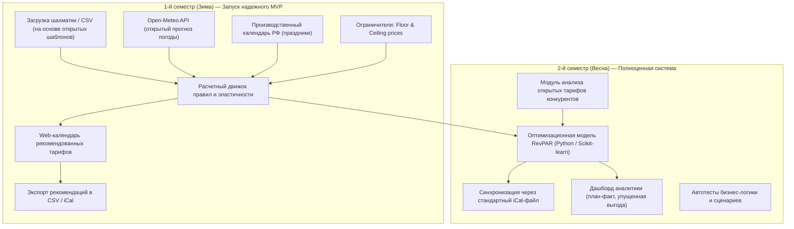

# Концепция курсового проекта: «Сервис динамического ценообразования для малых средств размещения (RevGlamp)»

Документ фиксирует согласованный выбор темы, границы продукта на два семестра, распределение ролей для 5 участников и готовые формулировки для защиты по бланкам дисциплины «Проектная деятельность».

---

## 1. Паспорт проекта

* **Рабочее название темы:** Разработка сервиса динамического ценообразования для малых средств размещения (загородные отели, глэмпинги, базы отдыха) — **«RevGlamp»** (*Smart Dynamic Pricing Engine*).
* **Предметная область из перечня:**
  * *Основная:* **Информационные системы управления бизнесом и прикладной анализ данных в туризме / HoReCa**.
  * *Смежные:* Алгоритмы управления доходностью (Revenue Management), автоматизация ценообразования, анализ открытых данных (Open Data & Weather API).
* **Тип по источнику:** **Проблема** (рыночная проблема малого загородного туризма, подтвержденная отраслевыми исследованиями и открытыми публикациями отельеров).
* **Потенциальный заказчик (целевой профиль владельца результата):** 
  * *Типаж / Профиль:* Собственник / генеральный управляющий малого загородного объекта размещения (10–25 домиков или сафари-тентов). 
  * *Привязка к рынку:* Профиль составлен на основе типовых бизнес-моделей участников **Ассоциации глэмпингов России (АСГ)** и кейсов отраслевых изданий (*Frontdesk.ru*, *TravelLine Blog*, *vc.ru*).
  * *Канал валидации:* Открытые профессиональные экспертные каналы и чаты отельеров (сообщества управляющих загородными базами в Telegram, профильные форумы HoReCa).
* **Основной пользователь:** Управляющий объектом или операционный менеджер (формирует тарифную политику, утверждает цены и выгружает их в каналы продаж).
* **Вторичный пользователь:** Администратор ресепшена (работает по утвержденной сетке цен в шахматке).
* **Заинтересованные стороны:** Гости базы отдыха (получают рыночную стоимость проживания).

---

## 2. Формулировка проблемы и текущий способ действий

### Проблема одним предложением (для Бланка Ж)
> *Управляющие малых загородных средств размещения (10–30 номеров) недополучают до 20% сезонной выручки и тратят до 4 часов в неделю на ручной пересчет тарифов из-за использования статичных сезонных цен, которые не реагируют на изменения темпа бронирования, погодные условия и открытые тарифы конкурентов.*

### Текущий способ действий и его цена (для Бланка Е)
1. **Шаг 1:** В начале сезона управляющий вручную заносит в таблицу Excel или простую шахматку 2 плоских тарифа: «Будни» (например, 6 000 руб.) и «Выходные» (например, 9 000 руб.).
2. **Шаг 2:** Раз в неделю управляющий вручную открывает сайты 3–4 соседних баз отдыха и сайт прогноза погоды на ближайшие выходные (тратит 3–4 часа в неделю).
3. **Шаг 3:** При спаде спроса (дождь, низкая глубина бронирования) управляющий спохватывается за 1–2 дня до заезда и вручную рассылает скидки в соцсетях/мессенджерах.
4. **Шаг 4:** При всплеске спроса (аномальное тепло, праздники, фестивали) домики раскупаются за 3–4 недели вперед по заниженной базовой цене, лишая объект пиковой маржинальности.
* **Итоговые потери объекта (расчетная модель на основе открытых кейсов рынка):**
  * *Потери времени:* 12–16 часов рутинного ручного анализа в месяц.
  * *Потери денег:* для базы на 15 домиков со средним чеком 7 500 руб./ночь потеря 1 200–1 500 руб. RevPAR в пиковые дни оборачивается **упущенной выручкой от 180 000 до 350 000 рублей в месяц** в высокий сезон.
* **Уровень доказательства:** 
  * 1 (открытые публикации, статьи и интервью владельцев глэмпингов в отраслевых медиа: Frontdesk.ru, vc.ru, кейсы Bnovo).
  * 2 (прямое наблюдение команды: мониторинг открытых тарифов и занятости баз на Яндекс.Путешествиях и сайтах глэмпингов Подмосковья).

---

## 3. Границы продукта и двухсеместровый роадмап (Принцип YAGNI и разработка MVP)

Проект автономен: работает на открытых источниках данных, синтетическом генераторе шахматки бронирований и бесплатных открытых API. Никаких закрытых корпоративных доступов и сложных DevOps-контейнеров (без Docker).

### 1-й семестр (Зима): Запуск рабочего MVP
**Фокус:** Базовый расчет эластичности по дням недели и темпу броней, учет погоды и праздников, веб-календарь тарифов с защитой от убытков.

* **Входит в MVP:**
  1. **Карточка объекта и номерного фонда:** базовый тариф, пороги цен (*Floor price* — себестоимость обслуживания номера, ниже нельзя; *Ceiling price* — максимальный потолок рынка).
  2. **Импорт истории бронирований:** загрузка шахматки в формате CSV (по структуре популярных систем бронирования) или ручной ввод текущей загрузки на 30–60 дней вперед.
  3. **Алгоритмическое ядро (Rule-based + параметрическая эластичность спроса):**
     * *Коэффициент набора броней (Booking Pace):* если загрузка на дату опережает нормальный график — цена динамически повышается.
     * *Глубина бронирования (Lead Time):* адаптивная скидка/наценка в зависимости от количества оставшихся дней до даты заезда.
     * *Погодный фактор:* автоинтеграция с нативным бесплатным `Open-Meteo API` (прогноз температуры и осадков на 14 дней без регистрации и ключей).
     * *Календарный фактор:* учет государственных праздников и переносов выходных дней.
  4. **Интерактивный Web-календарь:** наглядное отображение рекомендованных тарифов по дням с цветовой подсветкой спроса и кнопкой «Подтвердить / скорректировать».
  5. **Экспорт тарифов:** выгрузка утвержденных цен в `.csv` и по ссылке в формате `iCal` для вставки в шахматку.
* **Нижняя граница качества (Definition of Done для 1-го семестра):**
  * Расчет тарифов на 60 дней вперед выполняется за $p95 \le 1.0$ секунды.
  * 0 инцидентов выхода цены за пределы `[Floor_Price, Ceiling_Price]`.
  * На защите система работает на подготовленном демонстрационном датасете без ручного вмешательства команды в базу данных.
* **Порядок сокращения функций при отставании от графика:**
  1. В первую очередь сокращаем: визуальные графики динамики и карточки расширенной аналитики.
  2. Во вторую очередь: погодный фактор (оставляем только темп бронирования и праздничные дни).
  3. В системе всегда остается: базовый расчет рекомендаций цены по загрузке и экспорт в CSV.
* **Что ТОЧНО НЕ входит в MVP:**
  * Никаких платежей и эквайринга (интернет-эквайринг ЮKassa, Тинькофф Оплата и др. исключены полностью).
  * Никаких микросервисов, Docker-контейнеров и закрытых интеграций.

---

### 2-й семестр (Весна): Полноценная система для итоговой защиты курсовой
**Фокус:** Машинное обучение, расширенный анализ открытых данных конкурентов, экспорт через iCal и аналитика эффективности.

* **Функционал расширения:**
  1. **Модуль анализа конкурентов:** регулярный сбор и сравнение открытых витринных тарифов пула из 3–5 прямых конкурентов в локации.
  2. **Оптимизационная модель RevPAR:** модель прогноза вероятности бронирования в зависимости от цены и внешних факторов (Scikit-learn) с оптимизацией итоговой выручки.
  3. **Универсальный экспорт:** автосинхронизация по открытому стандарту iCal с популярными шахматками (Bnovo, TravelLine, RealtyCalendar).
  4. **Аналитический дашборд:** план-фактный анализ выручки, упущенной выгоды (lost revenue) и симуляция эффективности ценовых стратегий.
  5. **Надежность и качество:** автотесты бизнес-логики (pytest), итоговая проектная документация.

---

## 4. Распределение ролей в команде из 5 человек (для Бланка Б)

| № | Роль в проекте | Зона ответственности | Ключевой артефакт к сдаче (1 и 2 семестр) |
| :-: | :--- | :--- | :--- |
| **1** | **Белишко Кирилл** **Руководитель проекта (Project Manager / Team Lead)** | Управление границами проекта (скоуп), планирование спринтов и дедлайнов, координация команды, ведение бланков дисциплины и итоговой пояснительной записки, защита проекта. | План-график проекта, комплект отчетных бланков, итоговый отчет курсовой работы. |
| **2** | *Участник 2* **Бизнес-аналитик / Аналитик рынка** *(Market & Business Analyst)* | Исследование рынка малых средств размещения по открытым источникам (АСГ, отраслевые медиа), анализ тарифов конкурентов, финансовая модель потерь отельера (RevPAR/ADR), описание User Stories. | Аналитический отчет по конкурентам, реестр требований, сценарии использования (Use Cases). |
| **3** | *Участник 3* **Backend-разработчик** | Разработка серверной части (Python / FastAPI), схема базы данных (номера, сезоны, бронирования), логика фильтрации цен (Floor/Ceiling), экспорт в CSV/iCal. | Исходный код бэкенда, схема БД, REST API спецификация (Swagger). |
| **4** | *Участник 4* **Frontend-разработчик** | Клиентский веб-интерфейс (React/Vite), календарная сетка тарифов с подсветкой спроса, форма ввода базовых параметров отеля, карточка обоснования цены. | Исходный код клиентского приложения, интерфейс календаря цен. |
| **5** | *Участник 5* **Аналитик данных / Алгоритмист** *(Data Analyst / QA)* | Разработка математической модели ценообразования (коэффициенты эластичности, темп бронирования, дни недели), интеграция с Open-Meteo API, тестирование корректности расчетов. | Скрипты расчетного движка, демонстрационный датасет, отчет о тестировании алгоритма. |

---

## 5. Защита от критического риска типа «О» (Организационный)

* **Почему проект гарантированно не сорвется:**
  * Мы не зависим от договоренностей с закрытыми гостиничными сетями.
  * Исследование базируется на открытых отраслевых данных и репрезентативном синтетическом датасете, отражающем структуру реальных глэмпингов Подмосковья и ЦФО.
  * Интеграции строятся на общедоступном погодном API (`Open-Meteo`, бесплатный, без ключей) и общепринятом формате обмена календарями `iCal` (RFC 5545).

---

## 6. Заготовки для Бланка В (Сравнение вариантов темы)

* **Вариант 1 (Выбранный):** Сервис динамического ценообразования для малых средств размещения (RevGlamp).
  * *Обоснование:* реальный экономический эффект (рост RevPAR на 15–20%), четко измеримый результат, понятное разделение на 5 проектных ролей, масштабируемость на 2 семестра без бюрократических барьеров и сторонних зависимостей.
* **Вариант 2 (Отклоненный):** Сервис бронирования университетских аудиторий и коворкингов.
  * *Причина отклонения:* стандартный CRUD-календарь без прикладной аналитики; высокий риск блокировки из-за необходимости согласований регламентов доступа с комендантами корпусов.
* **Вариант 3 (Отклоненный):** Telegram-бот расписания группы.
  * *Причина отклонения:* недостаточный инженерный объем для курсовой работы команды из 5 человек на 2 семестра; дублирование уже созданных сервисов.

---

## 7. Требования к качеству системы (по Лекции №2)

1. **Производительность (Latency):**
   * Расчет тарифной сетки на 60 дней вперед: $p95 \le 1.0$ с.
   * Время отрисовки календаря в веб-интерфейсе: $p95 \le 200$ мс.
2. **Надежность (Reliability):**
   * Жесткая проверка границ: вероятность генерации цены ниже установленного пола (*Floor Price*) равна $0.0\%$.
3. **Доступность и простота эксплуатации:**
   * Локальный запуск без сторонних тяжелых контейнеров: приложение поднимается стандартными командами в виртуальном окружении Python.
4. **Сопровождаемость (Maintainability):**
   * Модульное разделение: расчетный модуль отделен от API и может тестироваться изолированно.
   * Покрытие базовых сценариев расчета модульными тестами (pytest) $\ge 80\%$.
