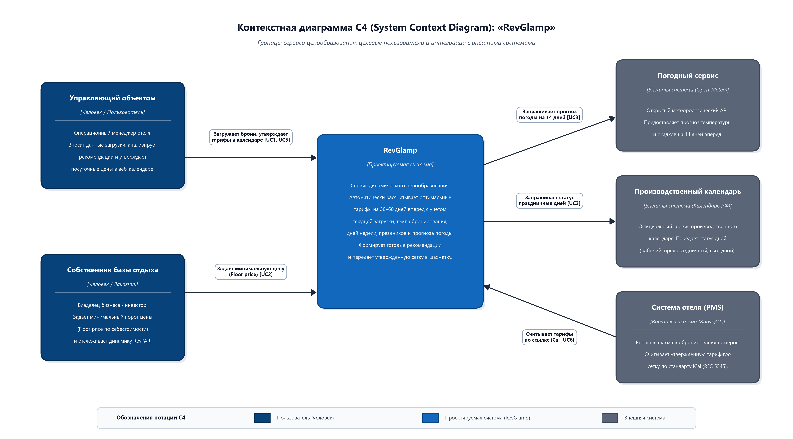

# Курсовой проект: «RevGlamp» — Сервис динамического ценообразования для малых средств размещения

Курсовая работа и сквозной проект по дисциплине **«Проектная деятельность»**.  
* **Учебное заведение:** РТУ МИРЭА  
* **Группа:** ЭФБО-17-25  
* **Преподаватель:** Семашко Евгений Александрович  
* **Руководитель проекта (Project Manager / Team Lead):** Белишко Кирилл Андреевич  
* **Размер команды:** 5 человек   

---

## 📌 Навигация по сданным практическим работам  

| Практика | Тема работы | Основные артефакты и бланки | Текстовая справка |
| :--- | :--- | :--- | :---: |
| **Паспорт проекта** | Общая концепция, архитектура и дорожная карта | [PROJECT_CONCEPT.md](PROJECT_CONCEPT.md) (DoD, роли, стейкхолдеры, метрики) | [Паспорт](PROJECT_CONCEPT.md) |
| **Практика №1** | Проблематизация, проектный фильтр и выбор темы | [Бланки А, Б, В](prd-pr01/), [Сводный отчет ПЗ-1 (.docx)](prd-pr01/Объединённый%20отчёт%20по%20практике%20№1.docx) | [READY_TO_SUBMIT_PZ1.md](prd-pr01/READY_TO_SUBMIT_PZ1.md) |
| **Практика №2** | Реестр аналогов, критерии сравнения и Product Vision | [Бланки Г–И, 1–10](prd-pr02/), [Сводный отчет ПЗ-2 (.docx)](prd-pr02/Объединённый%20отчёт%20по%20практике%20№2.docx) | [READY_TO_SUBMIT_PZ2.md](prd-pr02/READY_TO_SUBMIT_PZ2.md) |
| **Практика №3** | Use Case, раскадровка интерфейса и требования к качеству | [Раздаточные материалы, записка, NFR](prd-pr03/) | [READY_TO_SUBMIT_PZ3.md](prd-pr03/READY_TO_SUBMIT_PZ3.md) |
| **Практика №4** | Контекстная модель системы (C4 Context Diagram) | [Контекст системы (.docx)](prd-pr04/Практическое_занятие_№4_Контекст_системы_RevGlamp.docx), [Раздаточные материалы](prd-pr04/Практическое_занятие_№4_Раздаточные_материалы.docx) | [READY_TO_SUBMIT_PZ4.md](prd-pr04/READY_TO_SUBMIT_PZ4.md) |

---

## 🏗 Архитектура окружения: Контекстная диаграмма C4



*Полное описание акторов, внешних систем, потоков данных и связей со сценариями использования (Use Cases) представлено в [prd-pr04/READY_TO_SUBMIT_PZ4.md](prd-pr04/READY_TO_SUBMIT_PZ4.md).*

---

## 🎯 Суть проекта в 3 тезисах

* **Проблема:** Малые загородные базы отдыха и глэмпинги (10–35 номеров) используют статичные тарифы («будни» / «выходные»), теряя до 20% потенциальной выручки в сезон из-за невозможности вручную отслеживать темп бронирования, дни недели и прогноз погоды.
* **Решение:** Веб-сервис **«RevGlamp»** (*Smart Dynamic Pricing Engine*), рассчитывающий научно обоснованные посуточные тарифы на 30–60 дней вперед с учетом эластичности спроса, календаря праздников РФ и открытого прогноза погоды Open-Meteo.
* **Границы реализации (1-й семестр / MVP):** Локальный веб-интерфейс интерактивного календаря тарифов (FastAPI + React/Vite) с эвристическим расчетным движком, экспорт утвержденной сетки цен в CSV и по стандарту iCal (RFC 5545) для шахматок отеля (Bnovo / TravelLine). *Финансовые шлюзы и прием платежей исключены из контура системы (оплата осуществляется во внешней PMS).*

---

## 👥 Состав команды и зоны ответственности

1. **Белишко Кирилл Андреевич** — *Project Manager / Team Lead*: скоуп проекта, дорожная карта, архитектурная целостность, сборка и защита документации.
2. **Кабанов Арсений Алексеевич** — *Бизнес-аналитик / Аналитик рынка*: отраслевые профили (АСГ), реестр аналогов, сценарии использования (Use Cases), финансовая модель RevPAR.
3. **Сидорович Денис Сергеевич** — *Backend-разработчик*: ядро API (FastAPI), хранение тарифов (SQLite), экспорт расписания по стандарту iCal (RFC 5545).
4. **Вячин Максим Геннадьевич** — *Frontend-разработчик*: веб-интерфейс календаря тарифов (React, Vite), валидация пользовательского ввода и отображение рекомендаций.
5. **Петренко Владимир Николаевич** — *Аналитик данных / QA-инженер*: алгоритм эластичности спроса, интеграция с Open-Meteo API, тестирование граничных условий (Floor/Ceiling price).

---

## 📂 Структура репозитория

```text
kurswdocumentation/
├── PROJECT_CONCEPT.md          # Полный концепт и паспорт проекта (Roadmap, DoD, SLI/SLO)
├── README.md                   # Главный путеводитель по репозиторию
├── c4_context_diagram.png      # Фирменная контекстная C4 диаграмма высокого разрешения (300 DPI)
├── .gitignore                  # Исключение временных файлов Office и служебного окружения
│
├── prd-pr01/                   # Практическая работа №1 (Старт сквозного проекта и выбор темы)
│   ├── README.md               # Описание раздела ПЗ-1
│   ├── READY_TO_SUBMIT_PZ1.md  # Текстовая справка для защиты
│   ├── Бланк А.docx            # Стартовые ответы по выбранной теме
│   ├── Бланк Б.docx            # Состав команды и распределение ролей
│   ├── Бланк В.docx            # Сравнение вариантов темы проекта
│   └── Объединённый отчёт по практике №1.docx # Сводный отчет по ПЗ-1
│
├── prd-pr02/                   # Практическая работа №2 (Анализ рынка и видение продукта)
│   ├── READY_TO_SUBMIT_PZ2.md  # Текстовая справка и реестр аналогов
│   ├── Бланк Г-И + памятка.docx# Исследование проблемы и CustDev
│   ├── Бланки по практике №2.docx # Заполненные бланки 1–10 и Product Vision
│   ├── Объединённый отчёт по практике №2.docx # Сводный отчет по ПЗ-2
│   └── Часть лекции №2 для практики.docx # Материалы атрибутов качества
│
├── prd-pr03/                   # Практическая работа №3 (Use Case и пользовательские сценарии)
│   ├── READY_TO_SUBMIT_PZ3.md  # Текстовый реестр требований и сценариев
│   ├── Практическое_занятие_№3 — пояснительная_записка.docx   # Отчет команды
│   ├── Практическое_занятие_№3 — проверяемые_требования_к_качеству.docx # Метрики качества
│   └── Практическое_занятие_№3 — раздаточные_материалы.docx   # Бланки 1–10
│
└── prd-pr04/                   # Практическая работа №4 (Модель C4: Контекст системы)
    ├── READY_TO_SUBMIT_PZ4.md  # Текстовая справка и Mermaid-код
    ├── c4_context_diagram.png  # Контекстная диаграмма модели C4
    ├── Практическое_занятие_№4_Контекст_системы_RevGlamp.docx # Документ команды
    └── Практическое_занятие_№4_Раздаточные_материалы.docx  # Заполненные бланки 1–7
```
