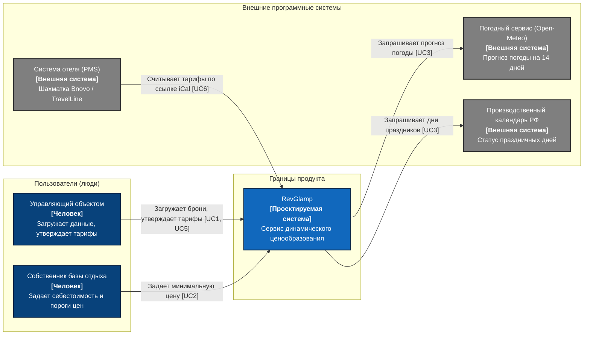

# Практическое занятие №4 (ПЗ-4): Контекстная диаграмма C4 (C4 Context Diagram)

> **Дисциплина:** Проектная деятельность  
> **Тема проекта:** Сервис динамического ценообразования для малых средств размещения — **«RevGlamp»**  
> **Группа:** ЭФБО-17-25  
> **Команда:** RevGlamp  
> **Руководитель проекта (PM):** Белишко Кирилл Андреевич  
> **Дата:** 10.10.2026  

---

## 1. Описание проектируемой системы (Бланк 1)

* **Название системы:** `RevGlamp` (Smart Dynamic Pricing Engine).
* **Назначение системы:** Веб-сервис динамического ценообразования, который автоматически рассчитывает и рекомендует оптимальные посуточные тарифы для управляющего загородным отелем или глэмпингом на основе темпа бронирования, дней недели и прогноза погоды, передавая готовую сетку цен в систему управления отелем отельера.

---

## 2. Перечень людей (ролей), работающих с системой (Бланк 2)

| Роль | Описание для диаграммы (кто это и зачем ему система) | Актор в ПЗ №3 | Сценарии (Use Case) |
| :--- | :--- | :---: | :---: |
| **Управляющий объектом** | Менеджер загородного отеля или глэмпинга: вводит параметры загрузки, просматривает рекомендации и утверждает тарифную сетку в веб-календаре | Да | UC1, UC5 |
| **Собственник базы отдыха** | Владелец бизнеса: определяет базовую финансовую модель, устанавливает минимальную цену себестоимости (*Floor price*) и просматривает сводку доходности | Да | UC2 |

---

## 3. Перечень внешних программных систем (Бланк 3)

| Внешняя система | Предоставляемый сервис | Какими данными обмениваемся и в какую сторону | Кто начинает обмен | Use Case |
| :--- | :--- | :--- | :---: | :---: |
| **Погодный сервис (Open-Meteo)** | Предоставляет открытый прогноз температуры и осадков | `RevGlamp → сервис`: координаты базы отдыха. `Сервис → RevGlamp`: прогноз температуры и осадков на 14 дней. | RevGlamp | UC3 |
| **Производственный календарь РФ** | Предоставляет официальный производственный календарь | `RevGlamp → сервис`: год и месяц. `Сервис → RevGlamp`: статус дней (рабочий, праздничный, предпраздничный, перенос). | RevGlamp | UC3 |
| **Система управления отелем (PMS)** | Внешняя шахматка бронирования отельера (Bnovo / TravelLine): ведет календарь номеров | `PMS → RevGlamp`: запрос тарифов по ссылке iCal. `RevGlamp → PMS`: обновленная сетка посуточных цен (или файл CSV). | Система управления отелем (PMS) / Управляющий | UC6 |

### Пять проверочных вопросов об окружении (Бланк 3, продолжение):
1. **Откуда система берёт данные, которые не вводит пользователь?**  
   *Ответ:* Из открытых внешних сервисов: прогноз погоды на 14 дней от Open-Meteo API и статус календарных дней из производственного календаря РФ (UC3).
2. **Как пользователь входит в систему?**  
   *Ответ:* По локальной учетной записи управляющего объектом (логин и пароль в самом сервисе). Вход через сторонние сервисы (Google, VK, Госуслуги) границами продукта не предусмотрен — внешней системы аутентификации нет.
3. **Как доставляются уведомления?**  
   *Ответ:* Внешних сервисов доставки уведомлений (SMS/Email-шлюзов) в системе нет: управляющий видит визуальные индикаторы и рекомендации непосредственно в веб-календаре при входе в систему.
4. **Куда система передаёт данные?**  
   *Ответ:* Система формирует файл CSV и постоянную ссылку по открытому стандарту iCal (RFC 5545). Внешняя система управления отелем (PMS) отельера считывает эти данные по ссылке для применения тарифов к витринам продаж (UC6).
5. **Кто принимает оплату (если она входит в продукт)?**  
   *Ответ:* **Оплата в продукт НЕ входит**. Гости оплачивают проживание непосредственно через шахматку отеля или на стойке регистрации. Финансовые шлюзы и эквайринг исключены из границ системы.

---

## 4. Перечень связей с подписями (Бланк 4)

| № | От (инициатор) | К (получатель) | Подпись (действие на естественном языке, без технологий) | Use Case |
| :-: | :--- | :--- | :--- | :---: |
| **1** | Управляющий объектом | RevGlamp | Загружает историю броней, просматривает рекомендации и утверждает тарифы в календаре | UC1, UC5 |
| **2** | Собственник базы отдыха | RevGlamp | Устанавливает минимальный порог себестоимости (*Floor price*) и просматривает сводку | UC2 |
| **3** | RevGlamp | Погодный сервис (Open-Meteo) | Запрашивает прогноз температуры и осадков по координатам базы отдыха | UC3 |
| **4** | RevGlamp | Производственный календарь РФ | Запрашивает статус рабочих, выходных и праздничных дней на период | UC3 |
| **5** | Система управления отелем (PMS) | RevGlamp | Считывает утвержденную сетку тарифов по ссылке iCal для обновления цен в шахматке | UC6 |
| **6** | Управляющий объектом | Система управления отелем (PMS) | Ведет бронирования гостей и управляет номерами во внешней шахматке *(связь окружения)* | Внешняя |

---

## 5. Контекстная диаграмма C4 (Бланк 5)

Изображение диаграммы сохранено в высоком разрешении (300 DPI): [c4_context_diagram.png](c4_context_diagram.png)

### Легенда диаграммы:
* **Синий прямоугольник (`#1168BD`):** Проектируемая программная система (`RevGlamp`).
* **Темно-синий прямоугольник (`#08427B`):** Человек (пользователь или заказчик).
* **Серый прямоугольник (`#888888`):** Внешняя программная система.
* **Сплошная стрелка с подписью:** Направление инициативы вызова и передачи данных; подпись описывает конкретное действие.

---

## 6. Что НЕ показано на контекстной диаграмме и почему (Бланк 5, продолжение)

| Элемент / роль | Причина исключения из диаграммы |
| :--- | :--- |
| **Гость базы отдыха (турист)** | Напрямую с сервисом не взаимодействует: бронирует домик через модуль PMS или сайт отеля. |
| **Администратор ресепшена** | Работает по готовым утвержденным ценам в шахматке PMS, отдельного сценария в расчетном сервисе не имеет. |
| **Платёжный сервис / эквайринг** | Операции с оплатой не входят в границы продукта (оплата исключена из системы по решению команды). |
| **База данных / веб-сервер RevGlamp** | Внутреннее устройство системы (относится к контейнерному уровню C4 Container, а не Context). |
| **Служба SMS/Email-рассылок** | Уведомления отображаются в самом веб-интерфейсе календаря, внешняя доставка не предусмотрена видением. |

---

## 7. Сверка и читаемость диаграммы (Бланки 6 и 7)

### Сверка (Бланк 6):
1. **Люди совпадают с акторами ПЗ №3:** Да (Управляющий и Собственник).
2. **Внешние системы совпадают с акторами ПЗ №3:** Да (Open-Meteo, Производственный календарь РФ, внешняя PMS).
3. **Каждый Use Case отражён в связях:** Да (UC1, UC2, UC3, UC5, UC6).
4. **Ничего из «в продукт не входит» нет на диаграмме:** Да (платежи, интернет-эквайринг, замки, мобильные приложения отсутствуют).
5. **Внутри системы нет её частей, технологий нет в подписях:** Да (нет названий фреймворков, баз данных, REST/HTTP).
6. **Все элементы имеют тип, описание и легенду:** Да.

### Проверка читаемости соседней командой (Бланк 7):
* **Что делает система?** — Рассчитывает посуточные цены на номера и рекомендует тарифы управляющему отеля на основе загрузки и погоды (Да, совпадает с замыслом).
* **Кто ей пользуется и зачем?** — Управляющий настраивает и утверждает тарифы в календаре, собственник задает минимальный порог себестоимости (Да, совпадает).
* **С какими внешними системами связана?** — Получает погоду от Open-Meteo, праздники из производственного календаря РФ, отдает готовую сетку тарифов в PMS отеля по ссылке iCal (Да, совпадает).
* **Что осталось непонятным?** — Все границы ясны; внутреннее устройство скрыто, как и требует стандарт C4 Context.
