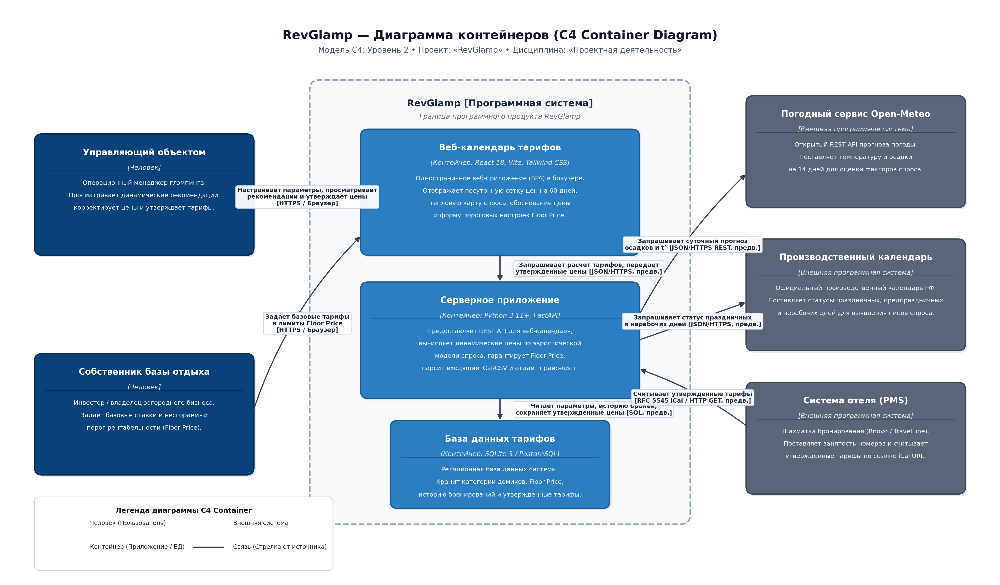
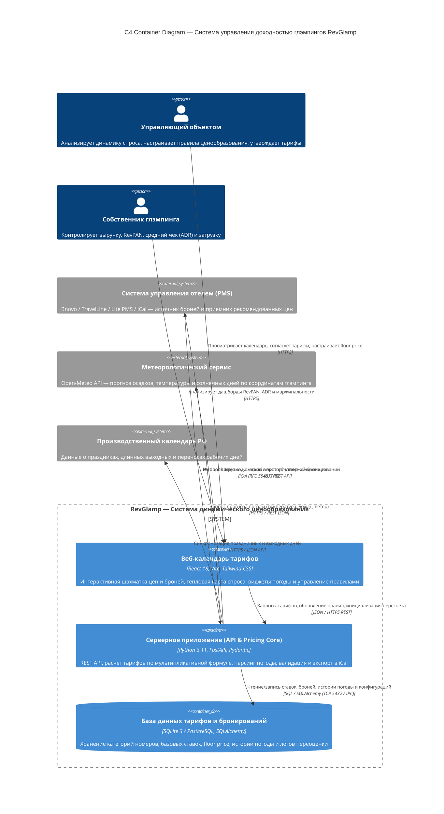

# Практическое занятие №5. Модель C4: Диаграмма контейнеров (Container Diagram)

**Дисциплина:** Проектирование программных систем / Архитектура информационных систем  
**Студент:** Белишко Кирилл Андреевич  
**Группа:** ЭФБО-17-25  
**Дата выполнения:** 17.10.2026  
**Проект:** RevGlamp — Система динамического ценообразования и управления доходностью загородных средств размещения (глэмпингов)

---

## 1. Цель и назначение работы

Разработка архитектурной диаграммы контейнеров (уровень 2 модели C4) для системы **RevGlamp**. Диаграмма контейнеров определяет высокоуровневую структуру программной системы, разделение на развертываемые единицы (web-приложение, backend-сервис, хранилище данных), используемый технологический стек и сетевые протоколы межконтейнерного взаимодействия.

Назначение разрабатываемой системы: автоматизация расчета оптимальных цен на номерной фонд глэмпинга на основе текущей загрузки, прогноза погоды, сезонности и производственного календаря с последующей выгрузкой в PMS/OTA.

---

## 2. Графическая диаграмма контейнеров C4

### Код диаграммы в формате Mermaid C4

---

## 3. Спецификация контейнеров системы RevGlamp

| Контейнер | Назначение и функциональная роль | Используемые технологии (стек) | Тип развертывания | Хранилище данных |
| :--- | :--- | :--- | :--- | :--- |
| **Веб-календарь тарифов (Frontend SPA)** | Клиентский интерфейс пользователя: интерактивная сетка дат и тарифов, графики загрузки, карточки правил ценообразования, ручной оверрайд цен, подтверждение пакетных изменений. | React 18, TypeScript/JavaScript, Vite, Tailwind CSS, Lucide Icons, предварительно | Статический бандл на Nginx / облачный CDN, исполнение в браузере клиента | LocalStorage / SessionStorage (токены сессий, UI-фильтры) |
| **Серверное приложение (Backend API & Core)** | Бизнес-логика: REST API, алгоритм динамического пересчета ($Price \ge Floor\_Price$), шлюзы внешних сервисов (погода, календарь), формирование фидов цен. | Python 3.11+, FastAPI, Pydantic v2, Uvicorn, httpx, APScheduler, предварительно | Docker-контейнер (Linux amd64), масштабируемый сервис приложений | Stateless (состояние сохраняется исключительно в БД) |
| **База данных тарифов и бронирований (Database)** | Централизованное реляционное хранение сущностей: категории жилья, базовые ставки, ограничения (floor/ceiling price), матрица броней, история рекомендаций и аудит. | SQLite 3 (для автономного развертывания / MVP) / PostgreSQL 15+ (для многопользовательского режима), SQLAlchemy 2.0 | Выделенный сервер СУБД / контейнер Docker с persistent volume | Реляционные таблицы со строгими внешними ключами и индексами по датам |

---

## 4. Спецификация межконтейнерного взаимодействия и внешних интеграций

| Источник (Откуда) | Приемник (Куда) | Протокол и формат данных | Назначение взаимодействия | Синхронность / Асинхронность |
| :--- | :--- | :--- | :--- | :--- |
| Веб-клиент (SPA) | Серверное приложение | HTTPS, REST API (JSON) | Получение сетки цен, сохранение правил ценообразования, ручная корректировка тарифа. | Синхронный (запрос-ответ) |
| Серверное приложение | База данных тарифов | SQL (SQLAlchemy ORM / Core, порт 5432 либо локальный IPC) | Выборка параметров номеров, сохранение рассчитанных тарифов, логов аудита и броней. | Синхронный транзакционный |
| Серверное приложение | Open-Meteo API | HTTPS, REST API (JSON) | Получение прогноза погоды на 7–14 дней (осадки, температура, УФ) для локации глэмпинга. | Асинхронный (фоновый планировщик каждые 4 ч) |
| Серверное приложение | Производственный календарь РФ | HTTPS, REST (JSON / XML) | Определение праздничных, предпраздничных дней и длинных выходных на текущий и следующий год. | Асинхронный (кэширование на 30 дней) |
| Серверное приложение | PMS отеля (Bnovo / TravelLine) | HTTPS, iCal (RFC 5545) / REST API | Экспорт утвержденных цен на номера, периодический импорт занятости жилых юнитов. | Асинхронный (поллинг / webhooks раз в 15 минут) |
| Управляющий / Собственник | Веб-календарь (SPA) | HTTPS (Web Browser) | Взаимодействие человека с графическим интерфейсом через браузер. | Интерактивный UI |

---

## 5. Архитектурные решения и обоснования (Таблица 3)

| Аспект архитектуры | Принятое проектное решение | Техническое и экономическое обоснование | Альтернативные варианты и причина отклонения |
| :--- | :--- | :--- | :--- |
| **Архитектурный стиль** | Модульный монолит с разделением на SPA и Stateless API | Оптимален для команд из 1–3 инженеров, снижает сетевые задержки и накладные расходы на оркестрацию. | Микросервисная архитектура отвергнута из-за избыточной сложности обслуживания и накладных расходов. |
| **Схема доступа к данным** | Доступ к БД исключительно через Серверное приложение (FastAPI) | Обеспечивает строгую валидацию бизнес-правил, исключает несанкционированные инъекции и защищает floor price. | Прямое обращение фронтенда к БД (BaaS) отклонено из-за недопустимости компрометации критической логики цен. |
| **СУБД на этапе MVP** | SQLite 3 с абстракцией SQLAlchemy и готовностью миграции на PostgreSQL | Нулевые требования к инфраструктуре при развертывании у небольшого глэмпинга; переход на PG без переписывания ORM. | NoSQL (MongoDB) отклонена: бронирования и тарифы требуют строгой транзакционности (ACID) и целостности связей. |
| **Стратегия интеграции с внешними API** | Кэширование внешних ответов и Fallback-механизм (погода = 1.0 при сбое) | Гарантирует бесперебойный расчет цен даже при отказе внешнего метеорологического провайдера или исчерпании квот. | Прямой синхронный вызов погоды в момент пользовательского запроса отклонен из-за риска зависания UI. |

---

## 6. Контрольные вопросы и ответы для защиты работы

1. **В чем ключевое отличие диаграммы контейнеров (уровень 2) от контекстной диаграммы (уровень 1)?**  
   *Ответ:* Контекстная диаграмма показывает систему как единый «черный ящик» в окружении пользователей и внешних систем. Диаграмма контейнеров «вскрывает» этот ящик и показывает развертываемые программные единицы (контейнеры), их технологический стек, разделение ответственности и сетевые протоколы взаимодействия.

2. **Почему веб-интерфейс не обращается напрямую к базе данных?**  
   *Ответ:* Прямой доступ клиента к базе данных нарушает безопасность (раскрытие реквизитов подключения), исключает централизованную валидацию бизнес-логики (правила минимальной цены floor price могут быть обойдены) и делает невозможным аудит операций.

3. **Что произойдет при отказе внешнего метеорологического сервиса Open-Meteo?**  
   *Ответ:* В архитектуре заложен паттерн Fallback: модуль погоды возвращает коэффициент погоды $K_{\text{weather}} = 1.0$ (нейтральный), фиксирует предупреждение в журнале событий, а алгоритм динамического ценообразования штатно производит пересчет по базовым правилам загрузки и сезонности.
