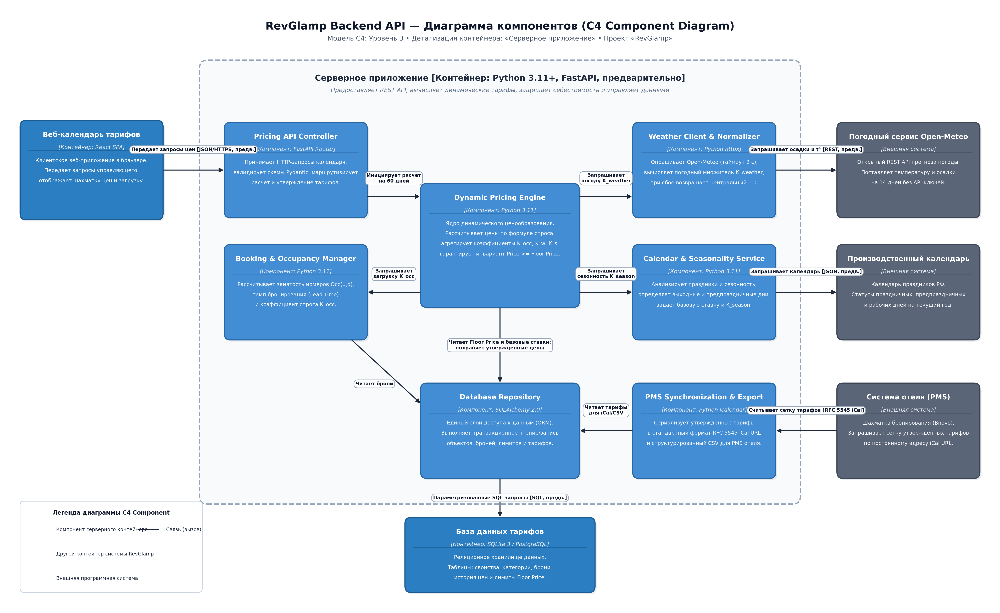
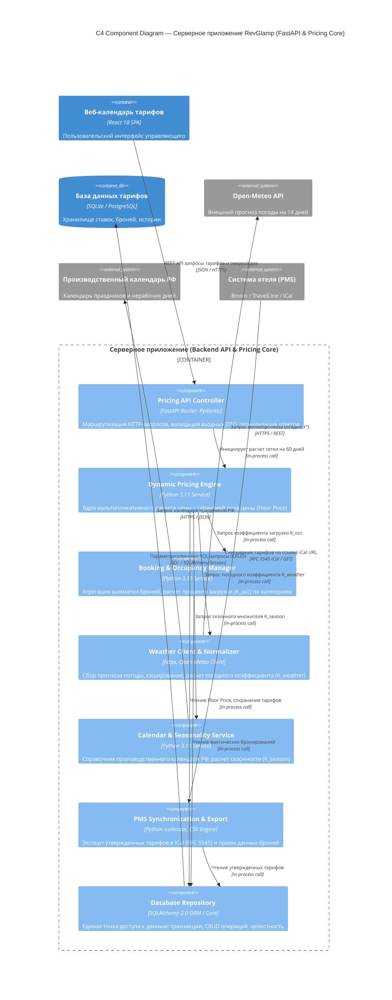

# Практическое занятие №6. Модель C4: Диаграмма компонентов (Component Diagram)

**Дисциплина:** Проектирование программных систем / Архитектура информационных систем  
**Студент:** Белишко Кирилл Андреевич  
**Группа:** ЭФБО-17-25  
**Дата выполнения:** 24.10.2026  
**Проект:** RevGlamp — Система динамического ценообразования и управления доходностью загородных средств размещения (глэмпингов)  
**Детализируемый контейнер:** Серверное приложение (Backend API & Pricing Core)

---

## 1. Цель и назначение работы

Разработка архитектурной диаграммы компонентов (уровень 3 модели C4) для ключевого контейнера **«Серверное приложение»** системы **RevGlamp**. Диаграмма компонентов отражает внутреннюю модульную структуру бэкенда, распределение функциональных обязанностей между программными модулями (контроллеры, сервисы, ядро расчета, репозитории), интерфейсы и протоколы их взаимодействия.

---

## 2. Графическая диаграмма компонентов C4

### Код диаграммы в формате Mermaid C4

---

## 3. Спецификация компонентов серверного приложения

| Компонент | Назначение и функциональная роль | Используемые классы / библиотеки | Входные данные | Выходные данные |
| :--- | :--- | :--- | :--- | :--- |
| **Pricing API Controller** | Прием входящих HTTP-запросов, проверка прав доступа, валидация входящих тел запросов по Pydantic-схемам, возврат JSON-ответов. | FastAPI Router, APIRouter, Pydantic BaseModel, HTTPBearer | HTTP Request (Query params, JSON Payload) | HTTP Response (JSON 200/400/422/500) |
| **Dynamic Pricing Engine** | Математический расчет рекомендованных цен по категориям и датам с применением коэффициентов спроса и жестким контролем минимальной цены (Floor Price). | Модуль `pricing_engine.py`, Python 3.11 math/decimal | Дата, категория, Base Price, Floor Price, шаг округления | Рекомендованная цена ($P_{\text{rec}}$), breakdown коэффициентов |
| **Booking & Occupancy Manager** | Анализ текущей занятости номерного фонда, вычисление процента заполняемости на выбранные даты и определение ступенчатого коэффициента спроса ($K_{\text{occ}}$). | Модуль `occupancy.py` / `importers.py` | Диапазон дат, ID категории, список броней | Процент загрузки ($0..100\%$), коэффициент $K_{\text{occ}}$ ($0.85..1.35$) |
| **Weather Client & Normalizer** | Опрос API Open-Meteo по географическим координатам глэмпинга, нормализация погодных факторов (осадки, температура) в погодный коэффициент ($K_{\text{weather}}$). | `httpx.AsyncClient`, In-memory TTLCache, `weather.py` | Широта, долгота, дата заезда/выезда | Прогноз погоды, коэффициент $K_{\text{weather}}$ ($0.90..1.15$) |
| **Calendar & Seasonality Service** | Расчет сезонного мультипликатора на основе дня недели (пятница/суббота vs будни), государственных праздников и школьных каникул РФ. | `calendar_service.py`, `datetime`, список праздников РФ | Календарная дата | Коэффициент $K_{\text{season}}$ ($0.95..1.40$), тип дня (будни/выходной/праздник) |
| **PMS Synchronization & Export** | Формирование фидов тарифов в стандартном формате iCal (RFC 5545) для автоматического считывания внешними PMS/OTA (Bnovo, TravelLine) и CSV выгрузки. | Библиотека `icalendar`, `csv`, FastAPI Response `text/calendar` | Матрица утвержденных тарифов по дням | Текстовый поток iCal (.ics) / CSV файл |
| **Database Repository** | Реализация паттерна Repository для изоляции работы с СУБД: абстракция транзакций, выполнение CRUD-операций, обеспечение целостности данных. | SQLAlchemy 2.0 (`Session`, `select`, `update`), ORM-модели | Запросы на выборку/сохранение от сервисов | Доменные объекты (Category, Rate, Rule, Booking) |
| **AI Advisory Copilot** | Формирование текстовых объяснений рассчитанной цены и рекомендаций управляющему (маркетинговые акции, спецпредложения при плохой погоде). | Модуль `ai_advisor.py`, LLM API Client | Входные метрики загрузки, погоды и динамики цен | Текстовые рекомендации на естественном языке |

---

## 4. Алгоритмическая основа Dynamic Pricing Engine

Расчет цены в модуле `Dynamic Pricing Engine` реализуется по строгой детерминированной мультипликативной формуле:

$$P_{\text{calc}} = P_{\text{base}} \times K_{\text{occ}} \times K_{\text{weather}} \times K_{\text{season}}$$

$$P_{\text{rec}} = \max\Big(Floor\_Price, \; \text{Round}\big(P_{\text{calc}}, \; \text{Step}\big)\Big)$$

Где:
- $P_{\text{base}}$ — Базовый утвержденный тариф за категорию номера в сутки (руб.);
- $Floor\_Price$ — Предельно допустимая минимальная цена (запрещено продавать ниже себестоимости обслуживания);
- $K_{\text{occ}}$ — Коэффициент текущей загрузки номерного фонда:
  - Загрузка $< 30\%$: $K_{\text{occ}} = 0.85$ (стимулирование раннего спроса);
  - Загрузка $30\% - 70\%$: $K_{\text{occ}} = 1.00$ (базовый баланс);
  - Загрузка $70\% - 90\%$: $K_{\text{occ}} = 1.15$ (повышенный спрос);
  - Загрузка $> 90\%$: $K_{\text{occ}} = 1.30$ (дефицит мест);
- $K_{\text{weather}}$ — Погодный коэффициент (для загородных баз отдыха ключевой фактор спонтанных поездок):
  - Ясно / тепло без осадков: $1.05 .. 1.15$;
  - Обычные среднесезонные условия: $1.00$;
  - Затяжные дожди / штормовое предупреждение: $0.90 .. 0.95$;
  - При отказе API погоды (Fallback): строго $1.00$;
- $K_{\text{season}}$ — Мультипликатор календаря:
  - Будние дни (пн–чт): $0.95 .. 1.00$;
  - Уикенд (пт–вс): $1.20 .. 1.30$;
  - Государственные праздники (майские, новогодние): $1.40 .. 1.50$;
- $\text{Step}$ — Шаг округления (обычно 100 или 500 рублей для визуальной чистоты тарифов).

---

## 5. Механизмы надежности, кэширования и безопасности (Таблица 3)

| Аспект реализации | Проектное решение | Инженерный механизм |
| :--- | :--- | :--- |
| **Отказоустойчивость внешних сервисов** | Защита от сбоев внешних API (Open-Meteo, LLM) | Паттерн Fallback с таймаутом (3 секунды). При таймауте погодного сервиса коэффициент принудительно выставляется в $1.0$, формируется warning в логе, пересчет не блокируется. |
| **Кэширование данных** | Минимизация повторных ресурсоемких расчетов и внешних HTTP-запросов | Кэширование прогнозов погоды в памяти процесса на 4 часа; кэширование производственного календаря на 30 дней. |
| **Гарантия минимальной маржинальности** | Защита от демпинга и финансовых ошибок | Программное условие `if calculated_price < floor_price: calculated_price = floor_price` встроено в ядро алгоритма и не может быть обойдено через API. |
| **Изоляция доступа к СУБД** | Защита от SQL-инъекций и утечки бизнес-логики | Паттерн Repository с ORM SQLAlchemy: параметризованные запросы, транзакционная изоляция, отсутствие сырых строковых SQL-конкатенаций. |

---

## 6. Контрольные вопросы и ответы для защиты работы

1. **Зачем выделять отдельный компонент Database Repository вместо прямого вызова ORM из контроллеров?**  
   *Ответ:* Паттерн Repository абстрагирует слой хранения данных от контроллеров и бизнес-логики. Это позволяет: во-первых, тестировать логику расчета цен (Pricing Engine) с моками без реальной БД; во-вторых, безболезненно сменить СУБД (например, перейти с SQLite на PostgreSQL), не затрагивая контроллеры и алгоритмы.

2. **Как в компоненте Dynamic Pricing Engine обеспечивается защита от продажи номеров ниже себестоимости?**  
   *Ответ:* В ядро расчета жестко внедрено правило проверки граничного условия: после перемножения базовой ставки на все коэффициенты загрузки, погоды и сезонности и округления применяется функция `max(floor_price, calculated_price)`. Если расчетное значение оказывается ниже порога окупаемости, система принудительно возвращает `floor_price`.

3. **Каким образом PMS-системы получают рассчитанные тарифы без прямой интеграции через закрытые API?**  
   *Ответ:* Компонент `PMS Synchronization & Export` генерирует динамический iCal-фид по стандарту RFC 5545 с уникальным токеном доступа. Любая PMS-система (TravelLine, Bnovo, 1C:Отель) поддерживает стандартный протокол подписки на внешние календари занятости и тарифов по защищенному URL, что исключает необходимость разработки платных кастомных шлюзов.
