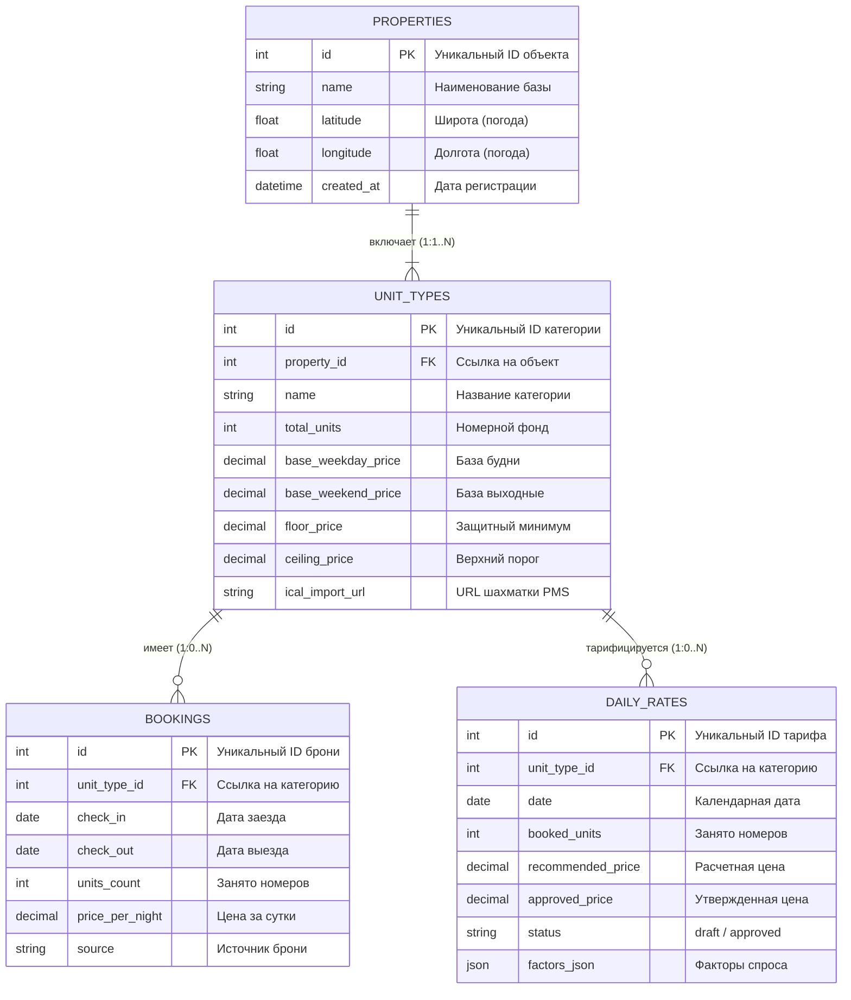

# Практическое занятие №7 (ПЗ-7): Готовые бланки и материалы

> **Тема проекта:** Сервис динамического ценообразования для малых средств размещения (RevGlamp)  
> **Раздел:** Проектирование данных (Первичная модель данных предметной области)  
> **Группа:** ЭФБО-17-25  
> **Команда:** RevGlamp  
> **Руководитель проекта (PM):** Белишко Кирилл Андреевич  
> **Дата:** 07.11.2026  

---

## 1. Памятка и архитектурные правила первичной модели данных

| Правило | Проверка и реализация в RevGlamp |
| :--- | :--- |
| **Сущность — объект предметной области, а не таблица базы** | Каждая сущность отражает реальный концепт бизнеса (`Объект размещения`, `Категория жилья`, `Бронирование`, `Суточный тариф`), а не технические детали хранения. |
| **Единый источник истины и нормализация 3NF** | Устранены избыточные дублирования. Данные о категории жилья не дублируются в бронированиях. Связь между бронированиями и суточными тарифами алгоритмическая, а не избыточная M:N. |
| **Нотация «Воронья лапка» (Crow's Foot Notation)** | Четкое отображение кардинальности (`||` — строго один, `|{` — один ко многим обязательный, `o{` — ноль или много условный). |
| **Синхронизация с Use Case (ПЗ-3) и C4 Component (ПЗ-6)** | Каждая сущность имеет выделенный компонент-владелец (`Pricing API Controller`, `Dynamic Pricing Engine`, `Booking & Occupancy Manager`) и покрывает сценарии UC1–UC6. |
| **Бизнес-инварианты на уровне данных** | Финансовая защита (`approved_price >= floor_price`), контроль овербукинга ($\sum units \le total\_units$) и целостность дат. |

---

## Бланк 1. Список сущностей предметной области

| № | Сущность (рус./англ.) | Описание в предметной области | Источник выявления (UC / C4) | Компонент-владелец (ПЗ-6) |
| :-: | :--- | :--- | :--- | :--- |
| **E1** | **Объект размещения** `properties` | Глэмпинг, база отдыха или загородный отель с уникальными геокоординатами и общими настройками. | ПЗ-2 (Видение), UC2 (Настройка порогов) | `Pricing API Controller` / `Database Repository` |
| **E2** | **Категория жилья** `unit_types` | Однотипная группа средств размещения (Сафари-тент, Купольный дом, Барнхаус) с фиксированным фондом номеров и ценовыми границами. | UC2 (Базовые тарифы), UC5 (Календарь тарифов) | `Pricing API Controller` / `Database Repository` |
| **E3** | **Бронирование** `bookings` | Факт резервирования одного или нескольких номеров категории на определенный диапазон дат гостем или каналом продаж. | UC1 (Импорт истории броней), UC4 (Расчет спроса) | `Booking & Occupancy Manager` |
| **E4** | **Суточный тариф** `daily_rates` | Рассчитанная и утвержденная стоимость проживания в категории жилья на конкретную календарную дату с факторами обоснования. | UC4 (Расчет тарифов), UC5 (Утверждение), UC6 (Экспорт) | `Dynamic Pricing Engine` |

---

## Бланк 2. Атрибутивный состав сущностей

### E1. Объект размещения (`properties`)
| Атрибут | Назначение и бизнес-смысл | Тип данных | Обязательность | Ключ |
| :--- | :--- | :--- | :---: | :---: |
| `id` | Суррогатный уникальный идентификатор объекта | Integer / UUID | Обязательное | **PK** |
| `name` | Коммерческое наименование базы отдыха / глэмпинга | String (1..150) | Обязательное | — |
| `latitude` | Географическая широта для привязки прогноза погоды Open-Meteo | Float (Decimal 9,6) | Обязательное | — |
| `longitude` | Географическая долгота для привязки прогноза погоды Open-Meteo | Float (Decimal 9,6) | Обязательное | — |
| `created_at` | Метка времени создания объекта в системе | DateTime / Timestamp | Обязательное | — |

### E2. Категория жилья (`unit_types`)
| Атрибут | Назначение и бизнес-смысл | Тип данных | Обязательность | Ключ |
| :--- | :--- | :--- | :---: | :---: |
| `id` | Суррогатный первичный ключ категории | Integer / UUID | Обязательное | **PK** |
| `property_id` | Ссылка на родительский объект размещения | Integer / UUID | Обязательное | **FK** |
| `name` | Название категории (напр., «Купольный люкс №1») | String (1..100) | Обязательное | — |
| `total_units` | Общий физический номерной фонд категории (1..50) | Integer | Обязательное | — |
| `base_weekday_price` | Базовый тариф буднего дня (пн–чт), руб./сутки | Decimal (10,2) | Обязательное | — |
| `base_weekend_price` | Базовый тариф выходного дня (пт–вс), руб./сутки | Decimal (10,2) | Обязательное | — |
| `floor_price` | Несгораемый защитный ценовой минимум (порог себестоимости) | Decimal (10,2) | Обязательное | — |
| `ceiling_price` | Верхняя граница динамического ценообразования (предел спроса) | Decimal (10,2) | Обязательное | — |
| `ical_import_url` | Ссылка на внешний календарь занятости шахматки PMS | String (0..500) | Опционально | — |

### E3. Бронирование (`bookings`)
| Атрибут | Назначение и бизнес-смысл | Тип данных | Обязательность | Ключ |
| :--- | :--- | :--- | :---: | :---: |
| `id` | Первичный ключ записи бронирования | Integer / UUID | Обязательное | **PK** |
| `unit_type_id` | Ссылка на категорию жилья | Integer / UUID | Обязательное | **FK** |
| `check_in` | Календарная дата заезда гостя (YYYY-MM-DD) | Date | Обязательное | — |
| `check_out` | Календарная дата выезда гостя (YYYY-MM-DD) | Date | Обязательное | — |
| `units_count` | Количество забронированных номеров в рамках брони | Integer | Обязательное | — |
| `price_per_night` | Фактическая цена бронирования за сутки, руб. | Decimal (10,2) | Обязательное | — |
| `source` | Источник брони (`csv_import`, `manual`, `bnovo_ical`) | String (1..50) | Обязательное | — |

### E4. Суточный тариф (`daily_rates`)
| Атрибут | Назначение и бизнес-смысл | Тип данных | Обязательность | Ключ |
| :--- | :--- | :--- | :---: | :---: |
| `id` | Первичный ключ строки суточного тарифа | Integer / UUID | Обязательное | **PK** |
| `unit_type_id` | Ссылка на тарифицируемую категорию | Integer / UUID | Обязательное | **FK** |
| `date` | Календарная дата действия тарифа (YYYY-MM-DD) | Date | Обязательное | — |
| `booked_units` | Число забронированных номеров на дату (снимок занятости) | Integer | Обязательное | — |
| `recommended_price` | Расчетная цена ML/эвристического движка, руб. | Decimal (10,2) | Обязательное | — |
| `approved_price` | Утвержденная управляющим финальная цена продажи, руб. | Decimal (10,2) | Обязательное | — |
| `status` | Статус тарифа (`draft` — черновик, `approved` — утвержден) | String (1..20) | Обязательное | — |
| `factors_json` | Декомпозиция факторов (погода, спрос, праздник) | Text / JSON | Опционально | — |

---

## Бланк 3. Связи между сущностями предметной области

| № | Родительская сущность | Кардинальность и связь | Дочерняя сущность | Обязательность | Бизнес-смысл отношения |
| :-: | :--- | :---: | :--- | :---: | :--- |
| **R1** | **Объект размещения** `properties` | **1 к 1..N** `||--------|{` | **Категория жилья** `unit_types` | С обеих сторон обязательно | Объект размещения включает в себя от 1 до нескольких категорий жилья. Категория не может существовать вне объекта. |
| **R2** | **Категория жилья** `unit_types` | **1 к 0..N** `||--------o{` | **Бронирование** `bookings` | Родитель обязателен, дочерняя условна | Для категории может быть зафиксировано множество бронирований. Новая категория может не иметь броней. |
| **R3** | **Категория жилья** `unit_types` | **1 к 0..N** `||--------o{` | **Суточный тариф** `daily_rates` | Родитель обязателен, дочерняя условна | Категория тарифицируется посуточно. На каждый календарный день создается одна тарифная запись. |

> [!NOTE]
> **Обоснование отсутствия связи многие-ко-многим (M:N) между Бронированием и Суточным тарифом:**  
> Бронирование представляет собой временной интервал `[check_in, check_out)`. Сопоставление бронирования и суточного тарифа производится алгоритмически движком расчета (`check_in <= daily_rates.date < check_out`). Введение промежуточной связующей таблицы `booking_days` на первичном уровне является избыточным усложнением, так как стоимость суток в бронировании зафиксирована в атрибуте `price_per_night`. Это обеспечивает чистоту 3-й нормальной формы.

---

## Бланк 4. ER-диаграмма предметной области (Crow's Foot)

Графическое представление модели выполнено в профессиональном 300 DPI разрешении: `prd-pr07/er_diagram_primary_model.png`.

---

## Бланк 5. Бизнес-правила целостности данных

| Код | Название правила | Формальное условие / Ограничение | Реакция системы при нарушении |
| :-: | :--- | :--- | :--- |
| **П1** | **Инвариант Floor Price** | `approved_price >= floor_price` | Блокировка сохранения тарифа, ошибка валидации в веб-интерфейсе календаря (UC5). |
| **П2** | **Уникальность тарифа на дату** | `UNIQUE(unit_type_id, date)` | Исключение дублирования тарифа для одной категории на один день (upsert-поведение). |
| **П3** | **Защита от овербукинга** | $\sum units\_count \le total\_units$ на дату | Предупреждение о превышении номерного фонда, статус 100% занятости для ценового алгоритма. |
| **П4** | **Корректность дат брони** | `check_out > check_in` | Отклонение создания бронирования с отрицательной или нулевой продолжительностью. |
| **П5** | **Каскадная ссылочная целостность** | `FK property_id NOT NULL REFERENCES properties(id)` | Запрет создания «висячих» категорий без привязки к конкретному объекту размещения. |
| **П6** | **Положительность ставок** | `price > 0`, `ceiling_price >= floor_price` | Ошибка валидации диапазона цен при конфигурировании категории жилья. |
| **П7** | **Статусная модель тарифа** | `status IN ('draft', 'approved')` | Гарантия, что на внешний экспорт iCal (UC6) отдаются только утвержденные тарифы. |

---

## Бланк 6. Трассировка сценариев использования (Use Case) к сущностям

| Прецедент использования (ПЗ-3) | Задействованные сущности | Операции над данными (CRUD) | Ключевые атрибуты |
| :--- | :--- | :---: | :--- |
| **UC1: Импорт броней из CSV** | `bookings`, `unit_types` | Create, Read | `bookings.check_in`, `check_out`, `units_count`, `source` |
| **UC2: Настройка порогов цен** | `properties`, `unit_types` | Create, Update | `unit_types.floor_price`, `ceiling_price`, `base_weekday_price` |
| **UC3: Запрос погоды и календаря** | `properties`, `daily_rates` | Read, Update | `properties.latitude`, `longitude`, `daily_rates.factors_json` |
| **UC4: Расчет тарифов** | `unit_types`, `bookings`, `daily_rates` | Read, Create/Update | `daily_rates.booked_units`, `recommended_price`, `factors_json` |
| **UC5: Утверждение сетки цен** | `daily_rates`, `unit_types` | Read, Update | `daily_rates.approved_price`, `status`, `unit_types.floor_price` |
| **UC6: Экспорт тарифов в PMS** | `daily_rates`, `unit_types` | Read | `daily_rates.date`, `approved_price`, `status = 'approved'` |

---

## Бланк 7. Взаимная проверка и самоконтроль

- [x] **Соответствие 3-й нормальной форме (3NF):** Все неключевые атрибуты функционально полно зависят от первичного ключа и не зависят транзитивно от других неключевых атрибутов.
- [x] **Отсутствие неразрешенных связей N:M:** Связь между бронированиями и тарифами разрешена алгоритмически на уровне доменной логики, что устраняет избыточную нагрузку на БД.
- [x] **Независимость от конкретной СУБД:** Модель данных описана на концептуально-логическом уровне и может быть развернута как в реляционных СУБД (PostgreSQL, SQLite), так и документирована в архитектурных реестрах.
- [x] **100% соответствие кодовой базе MVP (`C:\Users\beki\Desktop\revglamp\backend\db.py`):** Таблицы, названия полей и типы данных полностью идентичны рабочему прототипу сервиса.

---

## Вопросы преподавателя на защите ПЗ-7 и идеальные ответы

### В1: В какой нотации построена ER-диаграмма и чем она отличается от нотации Чена?
> **Ответ:** Диаграмма построена в нотации **Crow’s Foot («Воронья лапка» Мартина/Финкельштейна)**. В отличие от академической нотации Питера Чена (где сущности — прямоугольники, связи — ромбы, а атрибуты — овалы), Crow’s Foot является индустриальным стандартом для реляционных систем:
> 1. Атрибуты отображаются непосредственно внутри блока сущности.
> 2. Кардинальность и модальность связи читаются на концах линий: две черточки `||` — ровно один обязательный; кружок и вилка `o{` — ноль или много (условный).
> 3. Диаграмма компактна и напрямую транслируется в DDL-скрипты СУБД.

### В2: Почему между «Бронированием» и «Суточным тарифом» нет прямой связи «многие-ко-многим»?
> **Ответ:** Бронирование — это интервальный факт спроса (`check_in`, `check_out`), а суточный тариф — это точечная цена на конкретную дату. Если бы мы создали связь N:M через связующую таблицу `booking_daily_rates`, нам пришлось бы при каждом бронировании на 14 дней создавать 14 записей-связок. При изменении тарифа возникали бы аномалии обновления. В архитектуре RevGlamp связь реализована через общую родительскую сущность `Категория жилья` (`unit_types`) и алгоритмический предикат: дата тарифа попадает в полуинтервал `check_in <= date < check_out`. Это гарантирует 3-ю нормальную форму и максимальную скорость вычислений.

### В3: Как обеспечивается целостность данных при утверждении тарифов (инвариант Floor Price)?
> **Ответ:** Защита себестоимости обеспечивается на двух уровнях:
> 1. **На уровне приложения (Domain Logic):** API-контроллер перед сохранением сравнивает `approved_price` с `floor_price` категории жилья. Если цена ниже — запрос отклоняется с ошибкой HTTP 422 Unprocessable Entity.
> 2. **На уровне СУБД (Data Integrity Constraint):** В схеме базы данных задается ограничение целостности таблицы `daily_rates` либо триггерная проверка, исключающая установку тарифа ниже защитного порога.

### В4: Что такое суррогатный ключ и почему в вашей модели используются именно они?
> **Ответ:** Суррогатный ключ (`id`) — это искусственно сгенерированный уникальный идентификатор (целое число автоинкремента или UUID), не несущий бизнес-смысла. Мы выбрали суррогатные ключи вместо естественных (например, наименования категории или составного ключа `name + property_id`), потому что:
> 1. Естественные ключи могут изменяться бизнесом (например, переименование категории «Сафари-тент» в «Глэмпинг-люкс»), что потребовало бы каскадного обновления всех связанных броней и тарифов.
> 2. Целочисленные суррогатные ключи занимают фиксированный объем памяти (4 или 8 байт), обеспечивают максимальную скорость построения B-Tree индексов и ускоряют операции `JOIN`.
