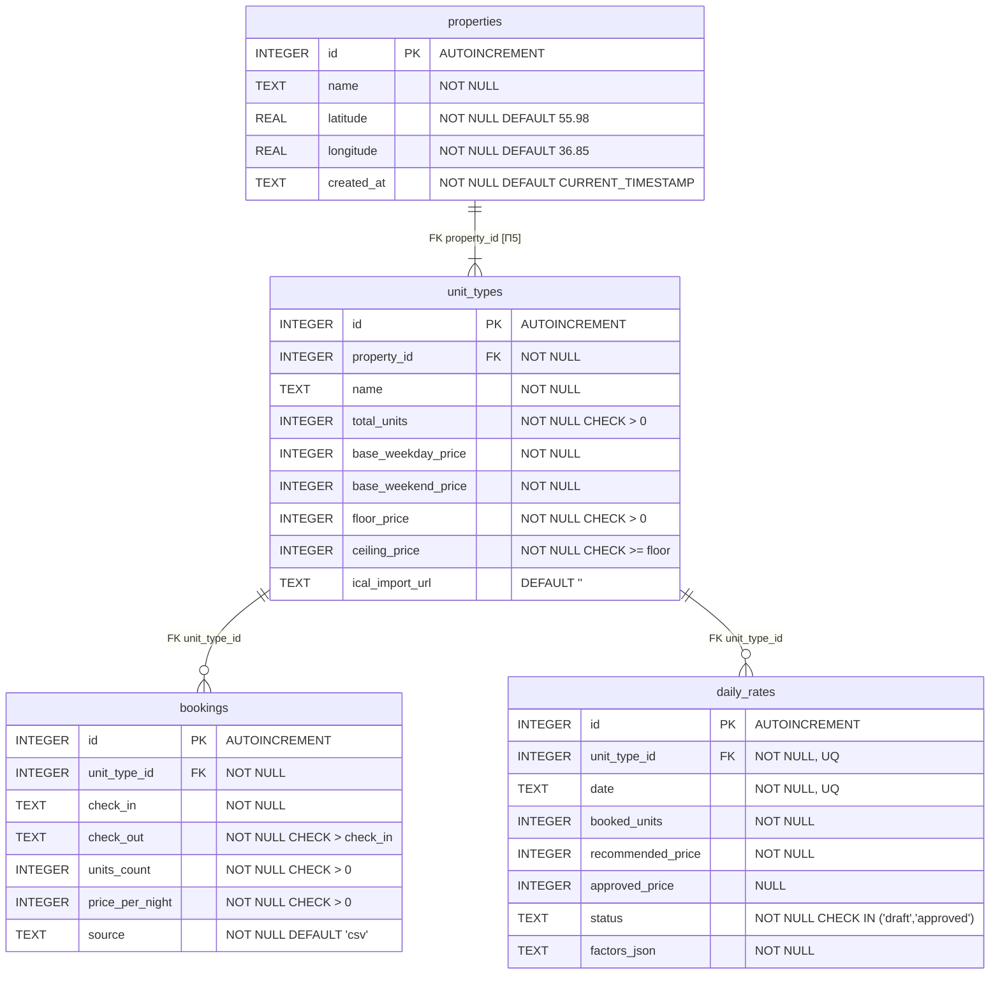

# Практическое занятие №8 (ПЗ-8): Готовые бланки и материалы

> **Тема проекта:** Сервис динамического ценообразования для малых средств размещения (RevGlamp)  
> **Раздел:** Технологии (Анализ вариантов стека, правила данных и физическая схема БД)  
> **Группа:** ЭФБО-17-25  
> **Команда:** RevGlamp  
> **Руководитель проекта (PM):** Белишко Кирилл Андреевич  
> **Дата:** 21.11.2026  

---

## Бланк 1. Входы и реестр технологического стека

* **Входные документы:** ПЗ №2 Видение продукта (26.09.2026), ПЗ №3 UC1–UC6 и НФТ1–НФТ4 (03.10.2026), ПЗ №4–6 C4 Context / Container / Component (10.10–24.10.2026), ПЗ №7 Первичная модель данных и правила П1–П7 (07.11.2026), Лекция «CAP, ACID, BASE».
* **Незакрытые вопросы ПЗ №7:**
  1. Многопользовательская модель прав «Собственник» vs «Управляющий» в облачной поставке (2-й семестр, отв. Белишко К.А.).
  2. Поведение при повышении `floor_price` собственником (UC2) относительно уже утверждённых тарифов (UC5) — вынесено на ПЗ №9.

| Часть системы (C4) | Технология и роль | Основание: UC, НФТ, ограничение | Статус проверки |
| :--- | :--- | :--- | :--- |
| **Веб-календарь тарифов (Frontend SPA)** | `React 18 + Vite 5 + Tailwind CSS 3` | UC1, UC2, UC5; НФТ4 ($\le 3$ мин); опыт команды | Принято предварительно |
| **Раздача статических файлов** | `FastAPI StaticFiles` (автономный MVP) / `Nginx` (продакшн) | Разделение сборки бандла и эксплуатации [К11] | Предварительно; уточнить площадку |
| **Серверное приложение (Backend API & Core)** | `Python 3.11+ + FastAPI 0.115 + Pydantic v2 + Uvicorn` | UC1–UC6; НФТ1 ($p95 \le 1.0$ с); НФТ2 (Floor Price) | Принято для проектирования [К6, К11] |
| **База данных тарифов и бронирований** | **КРИТИЧНЫЙ ВЫБОР:** `SQLite 3.35+` (per-tenant) vs `PostgreSQL 16` | ПЗ-7 E1–E4, правила П1–П7 | **Выбран Вариант А** (предварительно) |
| **Вход и права («Что не показано»)** | Однопользовательский локальный режим (MVP); Bearer JWT (2 сем.) | Границы MVP 1-го семестра (single-tenant) | Открытый вопрос 2-го семестра |
| **Погодный сервис (Open-Meteo API)** | `HTTPS REST JSON` (`httpx`, кэш 4 ч, fallback `K_weather = 1.0`) | UC3; CC BY 4.0 без API-ключей [К12] | Принято; деградация к ПЗ-9 |
| **Система отеля (PMS)** | Экспорт по `RFC 5545 iCalendar (.ics)` и `CSV` | UC1, UC6; НФТ3 ($\ge 99.5\%$ доступности) [К12] | Принято для проектирования |

---

## Бланк 2. Альтернативы и обязательные ограничения

* **Критичный выбор:** СУБД для контейнера «База данных тарифов и бронирований».
* **Вариант А:** `SQLite 3.35+` (stdlib `sqlite3`, режим `SQLite-per-tenant` `data/<slug>.db`, `WAL`, `PRAGMA foreign_keys = ON`).
* **Вариант Б:** `PostgreSQL 16` + драйвер `psycopg 3.1+` + `SQLAlchemy 2.0`.
* **Обязательные ограничения (ОУ1–ОУ3):**
  1. **ОУ1:** Атомарные ACID-транзакции по группе записей (UC1, UC4, UC5, П1–П3).
  2. **ОУ2:** Декларативные ограничения схемы `PK`, `FK`, `NOT NULL`, `UNIQUE(unit_type_id, date)`, `CHECK` (П2, П4–П7).
  3. **ОУ3:** Нулевая стоимость лицензии СУБД для малого глэмпинга (10–35 номеров, ПЗ-2).

---

## Бланк 3. Сравнение альтернатив и реестр источников (К1–К12)

| Критерий / Обязательное условие | Вариант А: `SQLite 3.35+` (per-tenant) | Вариант Б: `PostgreSQL 16` (`psycopg 3`) | Вывод |
| :--- | :--- | :--- | :--- |
| **[ОУ1] ACID по группе записей** | Соответствует (`with conn:` устойчив к сбоям [К1, К6]) | Соответствует (`BEGIN / COMMIT` [К7, К10]) | Оба пригодны |
| **[ОУ2] Схема (`PK, FK, UNIQUE, CHECK`)** | Соответствует при условии `PRAGMA foreign_keys = ON` на каждом соединении [К3, К4] | Соответствует по умолчанию [К8] | Пригодно для А при строгом `get_connection()` |
| **[ОУ3] Лицензия** | Public Domain (`0 ₽`) [К5] | PostgreSQL License (`0 ₽`) [К9] | Оба соответствуют |
| **[Кр1] Конкурентные операции (П1, П3)** | Сериализация писателей на файл (`BEGIN IMMEDIATE`), неблокирующее чтение в `WAL`, без `FOR UPDATE` [К2] | `Read Committed`, строчные блокировки `SELECT ... FOR UPDATE`, `Serializable` [К7] | Для 1–2 менеджеров А достаточен |
| **[Кр2] Эксплуатация и срок MVP** | Нулевое администрирование (in-process, stdlib `sqlite3`, рабочий код `db.py` [К5, К6]) | Отдельный серверный процесс, пулы соединений, `pg_dump`, +1.5–2 недели освоения | А снижает риск срыва сроков MVP |

### Источники команды (проверены 21.11.2026)
* **[К1]** SQLite — Transactional SQLite: https://www.sqlite.org/transactional.html
* **[К2]** SQLite — Isolation In SQLite & WAL: https://www.sqlite.org/isolation.html ; https://www.sqlite.org/wal.html
* **[К3]** SQLite — Foreign Key Support (§2): https://www.sqlite.org/foreignkeys.html
* **[К4]** SQLite — CREATE TABLE & UPSERT (3.24+): https://www.sqlite.org/lang_createtable.html ; https://www.sqlite.org/lang_upsert.html
* **[К5]** SQLite — Appropriate Uses & Copyright: https://www.sqlite.org/whentouse.html ; https://www.sqlite.org/copyright.html
* **[К6]** Python 3.11+ stdlib `sqlite3`: https://docs.python.org/3.11/library/sqlite3.html
* **[К7]** PostgreSQL 16 — Transaction Isolation & Row Locks: https://www.postgresql.org/docs/16/transaction-iso.html
* **[К8]** PostgreSQL 16 — Constraints (§5.4): https://www.postgresql.org/docs/16/ddl-constraints.html
* **[К9]** PostgreSQL — License & Versioning Policy: https://www.postgresql.org/about/licence/ ; https://www.postgresql.org/support/versioning/
* **[К10]** Psycopg 3.1+ — Transactions: https://www.psycopg.org/psycopg3/docs/basic/transactions.html
* **[К11]** FastAPI 0.115 — Static Files: https://fastapi.tiangolo.com/tutorial/static-files/
* **[К12]** Open-Meteo Docs & RFC 5545 iCalendar: https://open-meteo.com/en/docs ; https://datatracker.ietf.org/doc/html/rfc5545

---

## Бланк 4. Шесть вопросов CAP/ACID/BASE, физическая схема и защита правил

Графическая диаграмма физической схемы хранения (300 DPI): [physical_data_model_pz8.png](physical_data_model_pz8.png)

* **Защита опасных правил данных:**
  * **П1 (`approved_price >= floor_price`):** транзакционная проверка `unit_types.floor_price` внутри `override_single_rate()` под `BEGIN IMMEDIATE` (HTTP 422 при нарушении).
  * **П2 (`UNIQUE(unit_type_id, date)`):** составной индекс в схеме + атомарный `INSERT ... ON CONFLICT DO UPDATE` [К4].
  * **П3 (`SUM(units_count) <= total_units`):** подсчёт и вставка внутри монопольной пишущей транзакции `BEGIN IMMEDIATE` [К2].

---

## Бланк 5. Принятое решение, риски и обновление C4

* **Решение:** Предварительно выбран **Вариант А (`SQLite 3.35+`, stdlib `sqlite3`, `WAL`, `PRAGMA foreign_keys = ON`, `SQLite-per-tenant`)**.
* **Условие пересмотра:** Переход на `PostgreSQL 16` (`psycopg 3`), если более 10 пользователей работают с одним файлом БД или время ожидания блокировки записи превышает `200 мс` (тест НФТ1 до `05.12.2026`, отв. Петренко В.Н.), либо при запросе единой облачной отчётности.
* **Обновление C4:** В ПЗ №5 и ПЗ №6 контейнер БД переведён со статуса «SQLite / PostgreSQL, предварительно» на `SQLite 3.35+ (stdlib sqlite3, PRAGMA foreign_keys=ON)`.

---

## Бланк 6–7. Сверка, замечание читателей и задел к ПЗ №9

* **Замечание читателей:** *«`CHECK` в таблице `daily_rates` не защитит правило П1, если собственник повысит `floor_price` категории в `unit_types` поверх уже утверждённых тарифов»*.
* **Архитектурный компромисс на ПЗ №9:** Выбор протокола согласования П1 при изменении `floor_price` в `UC2` (каскадный сброс устаревших утверждённых тарифов в `draft` внутри транзакции vs отклонение повышения с `HTTP 409`) и деградация при отказе `Open-Meteo API`.

---

## Ответы на 9 вопросов самопроверки из теории ПЗ-8

1. **Какие части стека выбраны по сравнению, а какие общие?** По сравнению выбрана СУБД (`SQLite 3.35+ per-tenant` vs `PostgreSQL 16`). Общие: `Python 3.11+`, `FastAPI 0.115`, `React 18 + Vite`, `Open-Meteo API`, `RFC 5545 iCal`.
2. **Какое ограничение обязательно и откуда оно?** Бесплатность лицензий СУБД и API (`ОУ3` из бюджета малого глэмпинга ПЗ-2) и ACID-транзакции (`ОУ1`, `ОУ2` из ПЗ-3 НФТ2 и ПЗ-7 П1–П7).
3. **Можно ли найти свойство нужной версии по ссылке?** Да: источники `К1–К12` ведут на конкретные разделы документации SQLite 3.24+/3.45, Python 3.11+ и PostgreSQL 16.
4. **Чем подтверждённая возможность отличается от не проверенного результата?** Документация подтверждает наличие ACID, `WAL` и `ON CONFLICT` (`К1–К4`), а фактическое время ответа $p95 \le 1.0$ с под 50 запросами пока является оценкой и требует нагрузочного теста.
5. **Почему наличие транзакций не доказывает правильность последней брони?** Два параллельных импорта без монопольной блокировки записи (`BEGIN IMMEDIATE` или `SELECT FOR UPDATE`) могут оба прочитать свободный номер и вызвать овербукинг (гонка чтения-записи).
6. **Почему отсутствие `select_for_update` у SQLite не означает отсутствие транзакций?** SQLite поддерживает полные ACID-транзакции и сериализует пишущие транзакции на уровне файла (`WAL` + `BEGIN IMMEDIATE`) без строчных блокировок (`К1, К2`).
7. **Какие расходы не покрываются лицензией?** Стоимость облачного сервера/хостинга (во 2-м семестре), настройка резервного копирования файлов БД и трудозатраты команды на сопровождение.
8. **Какой недостаток принимаем и когда пересмотрим выбор?** Принимаем отсутствие строчной блокировки (`1 writer` на файл БД); пересмотрим на `PostgreSQL 16` при росте >10 конкурентных писателей на объект или ожидании блокировки >200 мс.
9. **Где отражено решение и какие вопросы открыты?** Отражено в Бланках 4–5 (физическая схема 4 таблиц SQLite и обновление C4 ПЗ-5/ПЗ-6); открыты тест НФТ1 на 50 потоков, добавление `CHECK` в `db.py` и компромисс П1 к ПЗ-9.
