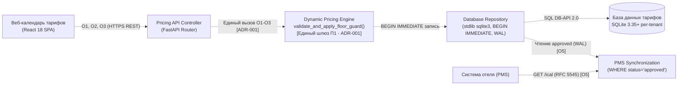

# Практическое занятие №9 (ПЗ-9): Готовые бланки и архитектурные решения (ADR)

> **Тема проекта:** Сервис динамического ценообразования для малых средств размещения (RevGlamp)  
> **Раздел:** Обоснование (Выбор архитектурного подхода, ADR-001 и ADR-002)  
> **Группа:** ЭФБО-17-25  
> **Команда:** RevGlamp  
> **Руководитель проекта (PM):** Белишко Кирилл Андреевич  
> **Дата:** 21.11.2026  

---

## Бланк 1. Вопрос решения и границы

* **Вопрос решения:** Каким способом система гарантирует соблюдение межтабличного правила **П1** (`approved_price >= floor_price`) при одновременных операциях правки тарифа управляющим (UC5), изменения порога себестоимости собственником (UC2) и экспорта цен в шахматку PMS (UC6)?
* **Архитектурная значимость (3 условия):**
  1. Меняет связи между компонентами `Pricing API Controller`, `Dynamic Pricing Engine` и `Database Repository` (ПЗ №6), может изменить схему `daily_rates` (ПЗ №7–8) и обеспечивает НФТ2 (100% защита себестоимости).
  2. Имеет 3 реализуемых варианта организации (А, Б, В).
  3. Варианты по-разному влияют на критерии `Т3` (число мест контроля в коде) и `Т4` (чистота 3НФ модели).
* **Уже решено и не пересматривается:** Модульный монолит из 3 контейнеров (ПЗ №5), 7 компонентов бэкенда на `Python 3.11+ / FastAPI 0.115` (ПЗ №6), `SQLite 3.35+` в режиме `SQLite-per-tenant + WAL + PRAGMA foreign_keys = ON` и схема из 4 таблиц (ПЗ №8).
* **Чего решение не решает:** Правило П3 (защита от овербукинга при импорте броней UC1), разграничение ролей RBAC (2-й семестр), версионирование истории прошлых сезонов и деградацию внешнего `Open-Meteo API` (оформлено отдельно как `ADR-002`).
* **Вопрос заказчику без ответа и допущение до ответа:** Что делать с уже утверждёнными (`approved`) тарифами будущих дат, если собственник в UC2 повышает `floor_price` выше них? **Допущение:** система в той же транзакции сбрасывает нарушающие даты в `'draft'` и сообщает их количество.

### Операции проверки (О1–О5)
| № | Операция | Use Case, шаг | Риск нарушения |
| :-: | :--- | :--- | :--- |
| **О1** | Ручная правка и утверждение тарифа одной даты | UC5, шаги 5–6, откл. 5а | Ввод цены ниже `floor_price` |
| **О2** | Пакетный пересчёт (60 дн.) и массовое утверждение | UC4 шаг 3, UC5 шаг 7 | Массовое утверждение устаревших черновиков |
| **О3** | Повышение `floor_price` категории собственником | UC2, шаг 2 | Старые утверждённые строки в `daily_rates` оказываются ниже нового порога (`CHECK` их не ловит) |
| **О4** | *Неблагоприятный случай:* одновременные О1 и О3 | UC5 + UC2 | Гонка чтения-записи TOCTOU: О1 читает старый порог и фиксирует убыточную цену после коммита О3 |
| **О5** | Экспорт утверждённых тарифов в PMS по ссылке iCal | UC6, шаги 2–4 | Отдача в шахматку продаж убыточного тарифа |

---

## Бланк 2–3. Требования и сравниваемые варианты

| № | Требование / Критерий | Вид | Источник | Приоритет |
| :-: | :--- | :-: | :--- | :-: |
| **Т1** | П1 (`approved_price >= floor_price`) выполняется на всех О1–О5, включая гонку О4 | **О** | ПЗ-3 НФТ2, UC5/UC6; ПЗ-7 П1 | — |
| **Т2** | При отказе О1 — `HTTP 422`; при О3 — число дат в `'draft'` без сбоев БД | **О** | ПЗ-3 UC5 откл. 5а | — |
| **Т3** | Минимум мест в коде, где разработчик обязан помнить о проверке П1 | **К** | Допущение команды | **1** |
| **Т4** | Минимальное изменение модели данных 3НФ (ПЗ №7) и схемы ПЗ №8 | **К** | ПЗ-7, ПЗ-8 | **2** |
| **Т5** | Защита П1 не замедляет чтение календаря и экспорт iCal (НФТ1, НФТ3) | **К** | ПЗ-3 НФТ1, НФТ3 | **3** |

* **Вариант А (Выбран):** Единый транзакционный шлюз в `Dynamic Pricing Engine` с монопольной пишущей транзакцией `BEGIN IMMEDIATE` и сбросом нарушающих дат в `'draft'`.
* **Вариант Б:** Копия порога `floor_price_snapshot` в таблице `daily_rates` + `CHECK` в БД (нарушает `Т4` 3НФ и требует синхронизации в 4 местах — хуже по `Т3`).
* **Вариант В:** «Оставить как есть» — проверка только в ручном оверрайде О1 (отброшен на проходе О3/О4 за нарушение обязательного `Т1`).

---

## Бланк 4–5. Полная запись архитектурного решения (ADR-001)

Графический фрагмент диаграммы компонентов после `ADR-001` (300 DPI): [adr_component_update_pz9.png](adr_component_update_pz9.png)

### ADR-001. Правило П1 (Floor Price) защищаем единым шлюзом Dynamic Pricing Engine с транзакцией BEGIN IMMEDIATE и сбросом нарушающих тарифов в 'draft'

* **Дата и статус:** 21.11.2026 | Статус: `принято для проектирования`.
* **Контекст:** Система «RevGlamp» (`Python 3.11+ / FastAPI 0.115 / React 18 / SQLite 3.35+` в режиме `SQLite-per-tenant` и `WAL`) обязана гарантировать П1 (`approved_price >= floor_price`) и НФТ2 (100% защита себестоимости) при О1–О5. Обычный `CHECK` в SQLite не контролирует межтабличную зависимость к `unit_types.floor_price`.
* **Рассмотренные варианты:** А — единый шлюз с `BEGIN IMMEDIATE` и сбросом нарушающих дат в `'draft'` (выбран); Б — столбец `floor_price_snapshot` + `CHECK` в `daily_rates` (отвергнут: нарушает 3НФ и требует синхронизации копий в 4 точках кода); В — проверка только в О1 (отвергнут: пропускает убыточные тарифы при повышении порога в О3/О4).
* **Решение:** Все мутации цен (О1, О2) и ценовых порогов (О3) проходят исключительно через `validate_and_apply_floor_guard()` в `Dynamic Pricing Engine` (прямой вызов записи порогов из `Pricing API Controller` в `Database Repository` исключается). Метод стартует пишущую транзакцию SQLite через `BEGIN IMMEDIATE` (`timeout=5.0` с), проверяет порог и при повышении `floor_price` переводит затронутые будущие тарифы в `status = 'draft', approved_price = NULL`. При понижении порога существующие утверждённые цены сохраняются. `PMS Synchronization` при экспорте iCal (О5) выбирает только `status = 'approved'`.
* **Последствия:**
  * *Положительные:* 100% соблюдение П1 при конкурентной гонке О4, сохранена 3НФ модели ПЗ-7, чтение календаря и iCal не блокируется (`WAL`).
  * *Отрицательные (цена):* защита опирается на единый программный шлюз (обходной SQL-запрос вне движка инвариант не поймает); пишущие операции к одному `.db` сериализуются в очередь; управляющему нужно переутвердить сброшенные даты; теряется страховка `CHECK` варианта Б.
  * *Сделать и проверить:* перевести UC2 в контроллере на шлюз, включить `BEGIN IMMEDIATE` в `db.py`, провести тест `pytest` на гонку О1+О3 и нагрузочный замер 50 потоков ($p95 \le 1.0$ с, до 05.12.2026).
* **Условия пересмотра:** 1) требование заказчика автоподнимать цены вместо сброса в `'draft'`; 2) появление внешних сервисов, пишущих в БД мимо шлюза; 3) ожидание блокировки записи $> 200$ мс.

### ADR-002. Погоду Open-Meteo запрашиваем прямым HTTP-вызовом с тайм-аутом 2.0 с, кэшем в RAM и fallback 1.0, без очереди и Redis

* **Дата и статус:** 21.11.2026 | Статус: `принято (оформлено из «Что не показано» ПЗ №5–6)`.
* **Контекст:** По UC3 при расчёте цен запрашивается прогноз `Open-Meteo API`; при сбое или ответе $> 2.0$ с используется нейтральный коэффициент $K_{\text{weather}} = 1.0$ (откл. 2а UC3).
* **Варианты:** А (выбран) — прямой асинхронный `httpx`-запрос до транзакции БД с тайм-аутом `2.0` с, локальным `TTLCache` (4 ч) и fallback `1.0`; Б — выделенный контейнер очереди сообщений / Redis (отвергнут: лишние инфраструктурные контейнеры и сопровождение без требования в ПЗ №3).
* **Последствия:** (+) 0 лишних контейнеров; (-) холодный запрос при сбое API ждёт тайм-аут до `2.0` с; локальный кэш не разделяется между несколькими воркерами. Пересмотр — при кластеризации бэкенда с общей квотой API.

---

## Бланк 6–7. Изменения документов и проверка соседней командой

* **Синхронизация документов:** ПЗ №3 (новое отклонение 2а в UC2), ПЗ №5–6 (обновление связи контроллер $\rightarrow$ движок и ссылки на `ADR-001` / `ADR-002` в «Что не показано»), ПЗ №7–8 (ссылка на `ADR-001` у П1 и настройка `BEGIN IMMEDIATE`).
* **Находка соседней команды (Бланк 7):** Вопрос №5 — *«Что произойдёт при понижении `floor_price` или уменьшении `ceiling_price`?»* Авторы дополнили раздел «Решение» нормой сохранения валидности утверждённых тарифов при понижении `floor_price` и уточнили границы `ceiling_price` в «Контексте».

---

## Ответы на 7 вопросов самопроверки из теории ПЗ-9

1. **Библиотека графиков на странице отчёта — нужна ли ADR?** Нет: решение обратимое, не влияет на контейнеры/компоненты/данные/НФТ и не создаёт дорогостоящих последствий.
2. **Чем обязательное условие отличается от критерия?** Обязательное условие действует как жёсткий фильтр (при невыполнении в любой операции вариант отбрасывается, как Вариант В на О3/О4), а критерии сравнивают оставшиеся пригодные варианты.
3. **В «Последствиях» только плюсы — что не так?** Команда не проанализировала цену решения (новую работу, сериализацию записи, риск обхода в коде) и не прошла неблагоприятные операции.
4. **Через месяц выбрали другой вариант — что с прежней ADR?** Старую запись не редактируют и не удаляют: ей меняют статус на «заменено записью ADR-00X», а новое решение оформляют новой записью.
5. **Точка компромисса для «хранить копию/счётчик vs вычислять/проверять в шлюзе»:** Где находится истина — в одном месте в таблице-источнике (чистая 3НФ и проще код, но правило защищает только код шлюза) или дублируется в дочерней таблице (есть страховка `CHECK` в БД, но риск расхождения копий в 4 операциях).
6. **Команда из 3 человек хочет 5 микросервисов «для современности» — какие вопросы задать?** Какое именно НФТ или Use Case одно приложение не выполняет? Готовы ли платить распределённой согласованностью вместо одной ACID-транзакции и поддержкой 5 деплоев (принцип *MonolithFirst* [Т5, Т6])?
7. **Зачем проходить варианты по операциям вместо общего описания?** Общее описание скрывает гонки и крайние случаи (как Вариант В выглядел корректным в О1, но сломался в О3 и О4).
